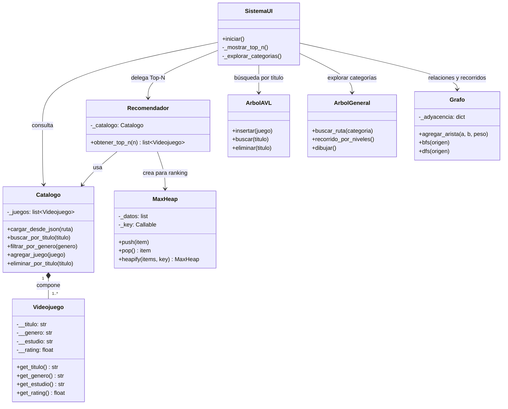

# 03 — Diagrama de clases / componentes

> Notación UML (simplificada). Se muestra por paquete: dominio, estructuras, servicios y UI.
> También se puede ver en [Mermaid](https://mermaid.live) con el bloque de la sección 4.

## 1. Clases de dominio (`modelos/`)

```
┌──────────────────────────────┐          ┌────────────────────────────────┐
│        Videojuego            │          │           Catalogo             │
├──────────────────────────────┤          ├────────────────────────────────┤
│ - __titulo: str              │          │ - _juegos: list[Videojuego]    │
│ - __genero: str              │   1    * │                                │
│ - __estudio: str             │ ◆────────│ + cargar_desde_json(ruta)      │
│ - __rating: float            │ compone  │ + buscar_por_titulo(t)         │
├──────────────────────────────┤          │ + listar_todos()               │
│ + get_titulo()               │          │ + agregar_juego(j)             │
│ + get_genero()               │          │ + eliminar_por_titulo(t)       │
│ + get_estudio()              │          │ + filtrar_por_genero(g)        │
│ + get_rating()               │          └────────────────────────────────┘
│ + __repr__()                 │
└──────────────────────────────┘
```

- **`Videojuego`**: atributos privados (`__`), getters públicos (encapsulamiento TP1).
- **`Catalogo`**: lista simple de juegos; es la fuente de verdad del sistema.

## 2. Estructuras de datos (`algoritmos/`, `estructuras/`)

```
┌─────────────────────┐   ┌──────────────────────┐   ┌─────────────────────┐
│  ArbolBinario (BST) │   │      ArbolAVL        │   │   ArbolGeneral      │
│  algoritmos/arbol.py│   │ algoritmos/arbol_avl │   │algoritmos/arbol_gen │
├─────────────────────┤   ├──────────────────────┤   ├─────────────────────┤
│ - _raiz: Nodo       │   │ - _raiz: NodoAVL     │   │ - _raiz: NodoGeneral│
├─────────────────────┤   ├──────────────────────┤   ├─────────────────────┤
│ + insertar(j)       │   │ + insertar(j)        │   │ + agregar_hijo(n,d) │
│ + buscar(t)         │   │ + buscar(t)          │   │ + buscar(d)         │
│ + eliminar(t)       │   │ + eliminar(t)        │   │ + buscar_ruta(d)    │
│ + recorrido_*()     │   │ + recorrido_*()      │   │ + recorrido_*()     │
│ + altura()          │   │ + altura()  [O(1)]   │   │ + dibujar()         │
└─────────────────────┘   └──────────────────────┘   └─────────────────────┘

┌────────────────────────┐   ┌───────────────────────────────┐
│  MaxHeap               │   │  Grafo                    │
│  estructuras/heap.py   │   │  algoritmos/grafo.py          │
├────────────────────────┤   ├───────────────────────────────┤
│ - _datos: list         │   │ - _adyacencia: dict           │
│ - _key: Callable       │   ├───────────────────────────────┤
├────────────────────────┤   │ + agregar_vertice(v)          │
│ + push(x) / pop()      │   │ + agregar_arista(a, b, peso)  │
│ + peek() / size()      │   │ + vecinos(v)                  │
│ + is_empty()           │   │ + bfs(origen) → (v, dist)  │
│ + heapify(items, key)  │   │ + dfs(origen) → orden      │
│ + _sift_up / _sift_down│   └───────────────────────────────┘
└────────────────────────┘
```

| Clase | Responsabilidad | Utilidad en el sistema |
|---|---|---|
| `ArbolBinario` | BST por título | Referencia didáctica + experimento de desbalance (TP3) |
| `ArbolAVL` | BST balanceado por título | **Búsqueda principal** del catálogo dinámico (TP4) |
| `ArbolGeneral` | Jerarquía n-aría de categorías | Explorar categorías con conteos (TP5) |
| `MaxHeap` | Cola de prioridad por rating | Ranking Top-N sin ordenar (TP6) |
| `Grafo` | Relaciones entre juegos | Juegos relacionados + BFS/DFS |

## 3. Servicios y UI (`servicios/`, `ui/`)

```
┌────────────────────────────┐         ┌──────────────────────────────┐
│       Recomendador         │         │         SistemaUI            │
│   servicios/recomendador   │         │       ui/terminal.py         │
├────────────────────────────┤         ├──────────────────────────────┤
│ - _catalogo: Catalogo      │         │ - _catalogo: Catalogo        │
├────────────────────────────┤         │ - _recomendador: Recomendador│
│ + obtener_top_n(n)         │         │ - _arbol: ArbolAVL           │
│   O(K + n log K)           │         │ - _arbol_general: ArbolGeneral│
│ + construir_grafo()        │         ├──────────────────────────────┤
│ + juegos_relacionados(j)   │         │ + mostrar_menu() / iniciar() │
│ + juego_mas_cercano(j) BFS │         │ + _mostrar_top_n()           │
│ + explorar_red(j)      DFS │         │ + _explorar_categorias()     │
└────────────────────────────┘         │ + _menu_grafo() / BFS / DFS  │
                                       └──────────────────────────────┘
```

> El grafo **no se guarda** en la UI: `Recomendador.construir_grafo()` lo
> reconstruye en cada consulta (catálogo chico y dinámico; ver §4 de `04-diagrama-datos.md`).

## 4. Relaciones entre clases (Mermaid)



**Tipos de flechas usados:**
- `◆──` composición (el `Catalogo` "dueña" de sus `Videojuego`).
- `──▶` asociación / uso (una clase invoca a otra).
- Herencia: no se usa (cada estructura es independiente; se optó por composición en la UI).
